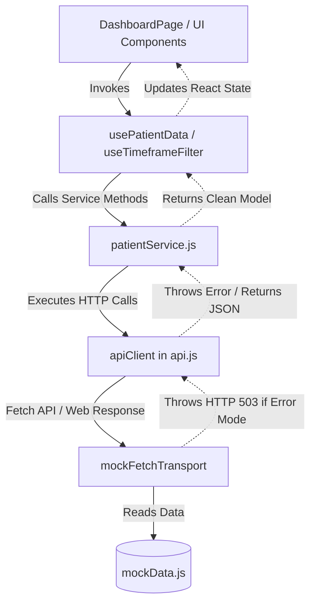

# PulseCare Clinical Health Monitoring Dashboard
> **Senior Frontend Engineering & Architectural Mentorship Project**

A modern, clinical-grade patient health dashboard built from the ground up with **React**, **Vite**, **Chart.js**, and modern **CSS3**. Engineered according to production frontend standards: strict separation of concerns, custom data-fetching hooks, accessible semantic markup, dynamic timeframe-based data visualization, and realistic mock REST API architecture.

---

## 📋 Table of Contents
1. [Project Overview](#project-overview)
2. [Key Features](#key-features)
3. [Folder Structure](#folder-structure)
4. [Tech Stack & Dependencies](#tech-stack--dependencies)
5. [API & Data Architecture](#api--data-architecture)
6. [Component Deep-Dive (Mentorship Guide)](#component-deep-dive-mentorship-guide)
   - [BloodPressureChart](#1-bloodpressurechartjsx)
   - [HealthMetricsGrid & MetricCard](#2-healthmetricsgridjsx--metriccardjsx)
   - [PatientProfileCard](#3-patientprofilecardjsx)
   - [YearlyStatsOverview](#4-yearlystatsoverviewjsx)
   - [DiagnosticList](#5-diagnosticlistjsx)
   - [LabResultsCard](#6-labresultscardjsx)
   - [LoadingSkeleton & ErrorAlert](#7-loadingskeletonjsx--erroralertjsx)
7. [Custom Hooks & Lifecycle Flow](#custom-hooks--lifecycle-flow)
8. [Setup & Execution Instructions](#setup--execution-instructions)
9. [Common Debugging Scenarios & Troubleshooting](#common-debugging-scenarios--troubleshooting)
10. [Student Practice Exercises](#student-practice-exercises)

---

## 1. Project Overview

Modern healthcare interfaces demand strict data clarity, high performance, and fault tolerance. In medical EHR (Electronic Health Record) software, a missing vital sign or a misaligned chart scale is not just a UI bug—it impairs clinical judgment.

This project simulates a real-world cardiovascular clinic dashboard. It demonstrates how to consume asynchronous patient streams, decouple UI components from network logic, render interactive canvas charts with dual vital sign curves, and manage loading and error boundaries gracefully.

---

## 2. Key Features

- **Dynamic Dual-Series Blood Pressure Chart**: Visualizes both Systolic and Diastolic pressure using Chart.js with responsive canvas resizing, bezier tension curves, and AHA clinical classification tooltips.
- **Interactive Timeframe Filtering**: Switch dynamically between `Last 6 Months`, `Last 1 Year`, and `All History` without hardcoded component state.
- **Real-Time Health Metric Tiles**: Highlights Respiratory Rate, Body Temperature, Heart Rate, and Oxygen Saturation (SpO2) with clinical status badges and trend indicators.
- **Complete Patient Information Card**: Displays demographics, date of birth, emergency contact, active insurance policy, and clinical drug allergies.
- **Yearly Health Statistics**: Computes combined annual blood pressure averages, clinical stability index, and medication adherence.
- **Diagnostic History & Lab Results**: Tabular records of active/resolved clinical problems and diagnostic pathology panels.
- **Resilient Network & Error Simulation**: Built-in test toggle for HTTP 503 error boundaries and loading skeleton screens.

---

## 3. Folder Structure

```
adobe/
├── index.html                     # HTML5 entry point with Plus Jakarta Sans typography
├── vite.config.js                 # Vite bundler configuration & local security binding
├── package.json                   # Project dependencies and npm scripts
├── test/
│   └── verify.js                  # Node.js ESM verification script for API & calculations
└── src/
    ├── main.jsx                   # React 19 application mounting with StrictMode
    ├── App.jsx                    # Root view controller & layout provider
    ├── assets/                    # Icons and synthetic assets
    ├── utils/
    │   ├── constants.js           # Clinical thresholds, status enums, timeframe keys
    │   ├── formatters.js          # Dates, units, and phone number sanitization
    │   └── healthCalculators.js   # AHA blood pressure & vitals range classification
    ├── services/
    │   ├── mockData.js            # Synthetic clinical EHR patient database
    │   ├── api.js                 # Core Fetch API wrapper with AbortController & error handler
    │   └── patientService.js      # Domain service methods (getPatient, getBloodPressureHistory)
    ├── hooks/
    │   ├── usePatientData.js      # Patient EHR data lifecycle hook (loading, error, refetch)
    │   └── useTimeframeFilter.js  # Dynamic blood pressure timeframe query hook
    ├── styles/
    │   ├── variables.css          # Clinical design tokens (colors, radii, shadows, typography)
    │   ├── index.css              # Reset, typography, accessible focus outlines, custom scrollbars
    │   ├── components.css         # Reusable card, badge, skeleton, button, and banner styles
    │   └── dashboard.css          # Responsive 2-column grid, sidebar, and chart layout
    ├── pages/
    │   └── DashboardPage.jsx      # Top-level page orchestrating hooks and widgets
    └── components/
        ├── common/
        │   ├── Card.jsx           # Surface card wrapper with header and action slots
        │   ├── Badge.jsx          # Contextual clinical status pill
        │   ├── StatTrendBadge.jsx # Directional arrow indicator (up/down/steady)
        │   ├── LoadingSkeleton.jsx# Shimmer skeleton layout for perceived performance
        │   └── ErrorAlert.jsx     # Network error alert with retry button
        ├── layout/
        │   ├── Layout.jsx         # Responsive application shell
        │   ├── Header.jsx         # Clinic navigation bar & mock error toggle
        │   └── Sidebar.jsx        # Navigation sidebar with attending physician footer
        └── dashboard/
            ├── BloodPressureChart.jsx  # Interactive dual-axis vital sign chart
            ├── HealthMetricsGrid.jsx   # 4-card vitals container
            ├── MetricCard.jsx          # Individual vital sign tile
            ├── PatientProfileCard.jsx  # Demographics, insurance, and emergency contact
            ├── YearlyStatsOverview.jsx # Annual aggregates and stability index
            ├── DiagnosticList.jsx      # Historical problem & diagnosis table
            └── LabResultsCard.jsx      # Diagnostic pathology panel list with PDF download
```

---

## 4. Tech Stack & Dependencies

| Technology | Purpose | Why Selected |
| :--- | :--- | :--- |
| **React 19** | Component Architecture | Industry-standard declarative UI library using functional components and hooks. |
| **Vite 6** | Build & Dev Tool | Extremely fast Hot Module Replacement (HMR) and optimized Rollup bundling. |
| **Chart.js & react-chartjs-2** | Vital Sign Visualization | High-performance HTML5 Canvas chart engine supporting dual datasets, custom tooltips, and responsive layout. |
| **Lucide React** | Clinical Iconography | Lightweight, tree-shakeable SVG icons for vital signs and navigation. |
| **Vanilla CSS3 Custom Properties** | Design System | Predictable styling without heavy third-party framework overhead. |

---

## 5. API & Data Architecture



### Key Senior Architecture Patterns:
1. **Never Hardcode Endpoints in Components**: UI components never call `fetch()` directly. They import `patientService`.
2. **Standard Web Primitives**: `api.js` utilizes standard `fetch()`, `Response`, and `AbortController`.
3. **Resilience & Testing**: Includes a toggleable `setSimulateError()` to let students verify error boundary states on demand.

---

## 6. Component Deep-Dive (Mentorship Guide)

### 1. `BloodPressureChart.jsx`
- **What it does**: Renders an interactive dual-line chart visualizing Systolic (pink-red) and Diastolic (purple) blood pressure across selected timeframes.
- **Why it is needed**: Clinical staff need to identify trends (e.g., spikes during spring or post-medication drops) rather than evaluating isolated numbers.
- **How it works internally**:
  1. Registers modular Chart.js controllers (`LineElement`, `PointElement`, `CategoryScale`, `LinearScale`, `Tooltip`).
  2. Maps API observation records into Chart.js dataset formats using `useMemo`.
  3. Uses `classifyBloodPressure()` in the tooltip callback to display clinical assessments (e.g. *Elevated*, *Stage 1 Hypertension*).
- **React concepts used**: `useMemo`, prop passing, conditional rendering, external library integration.
- **API integration**: Controlled by `useTimeframeFilter`, which requests `/api/patients/:id/blood-pressure?timeframe=6m|1y|all`.
- **How to extend**: Add a horizontal annotation line (e.g., at 130 mmHg) to show the clinical hypertension cutoff.

### 2. `HealthMetricsGrid.jsx` & `MetricCard.jsx`
- **What it does**: Displays the 4 real-time core vital signs: Respiratory Rate, Temperature, Heart Rate, and Blood Oxygen (SpO2).
- **Why it is needed**: Clinicians need an instant at-a-glance status overview of current patient physiology.
- **How it works internally**: Iterates through patient vitals and injects specialized background gradients, status pills, and trend arrows.
- **React concepts used**: Pure functional presentation, composition pattern, destructuring props.
- **How to extend**: Add a click handler that opens a modal with a detailed historical graph for that specific vital sign.

### 3. `PatientProfileCard.jsx`
- **What it does**: Renders patient demographics, photo, emergency contacts, insurance policies, and allergies.
- **Why it is needed**: Ensures clinical identification accuracy and prevents adverse drug interactions.
- **How it works internally**: Formats incoming raw data using `formatDate()` and `formatPhoneNumber()`, safely maps the allergy array, and alerts on empty allergy lists (NKDA).
- **React concepts used**: Conditional rendering, semantic HTML `<article>`, defensive rendering for nullable objects.

### 4. `YearlyStatsOverview.jsx`
- **What it does**: Displays annual KPI aggregates: average BP, vitals stability index, and medication adherence.
- **Why it is needed**: Chronic disease management relies on longitudinal compliance rather than short-term readings.
- **How it works internally**: Formats statistical metrics into a 2x2 grid and calculates the progress bar width dynamically.

### 5. `DiagnosticList.jsx`
- **What it does**: Tabulates current and past clinical conditions with severity indicators and diagnosis dates.
- **Why it is needed**: Medical history context is required before diagnosing or prescribing new treatments.
- **How it works internally**: Semantic accessible `<table>` with `<thead>`, `<tbody>`, and severity color mapping.

### 6. `LabResultsCard.jsx`
- **What it does**: Displays recent blood, lipid, and metabolic laboratory panels with simulated PDF downloads.
- **Why it is needed**: Physicians must verify laboratory panels to confirm diagnoses.
- **How it works internally**: Renders a list of lab cards with date formatting and accessible download triggers.

### 7. `LoadingSkeleton.jsx` & `ErrorAlert.jsx`
- **What it does**: Manages loading and failure states.
- **Why it is needed**: Network calls take time or can fail. Blank screens cause confusion; skeletons improve perceived performance, and error alerts provide recovery actions.

---

## 7. Custom Hooks & Lifecycle Flow

### `usePatientData(patientId)`
```javascript
const { patient, loading, error, refetch } = usePatientData('pat_001');
```
1. Initializes `loading: true`, `error: null`, `patient: null`.
2. Creates an `AbortController` instance.
3. Calls `patientService.getPatient(patientId, signal)`.
4. On success: updates `patient` state and sets `loading: false`.
5. On error: skips `AbortError` (from component unmounting) and stores real network errors in `error`.
6. Cleanup function calls `controller.abort()` to prevent race conditions and memory leaks.

---

## 8. Setup & Execution Instructions

### Prerequisites
- Node.js v18+ or v20+ installed
- npm or yarn package manager

### 1. Installation
```bash
npm install
```

### 2. Start Development Server
```bash
npm run dev
```
Open your browser at `http://localhost:3000`.

### 3. Run Automated Quality Assurance Verification
```bash
node test/verify.js
```

### 4. Build for Production
```bash
npm run build
```

---

## 9. Common Debugging Scenarios & Troubleshooting

| Symptom | Cause | Solution |
| :--- | :--- | :--- |
| **Canvas chart stretches or overflows on mobile** | Missing `maintainAspectRatio: false` or unconstrained parent container | Ensure the wrapping container has an explicit height (e.g. `height: 290px`) and `position: relative`. |
| **Chart tooltip shows [object Object]** | Incorrect tooltip callback return format | In Chart.js, tooltip callbacks must return a string or an array of strings. |
| **Memory leak warning: "Can't perform a React state update on an unmounted component"** | Unfinished fetch updating state after unmount | Implement `AbortController` in `useEffect` cleanup (see `usePatientData.js`). |
| **Network failure when testing offline** | Missing error boundary or try/catch | Check that your service layer validates `response.ok` before calling `response.json()`. |

---

## 10. Student Practice Exercises

1. **Exercise 1 (Beginner)**: Add a new metric tile for **Blood Glucose** (value: 94 mg/dL, status: Normal, icon: Droplet) to `HealthMetricsGrid.jsx`.
2. **Exercise 2 (Intermediate)**: Implement a new timeframe button in `BloodPressureChart.jsx` for **"Last 3 Months"** (`3m`) and add the matching filter logic in `api.js`.
3. **Exercise 3 (Advanced)**: Add a search input above the `DiagnosticList.jsx` table that filters conditions in real time using a `searchTerm` state.

